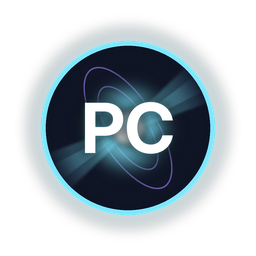
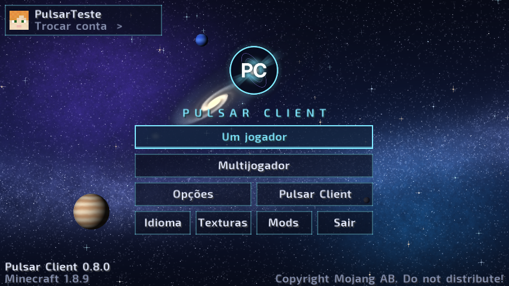
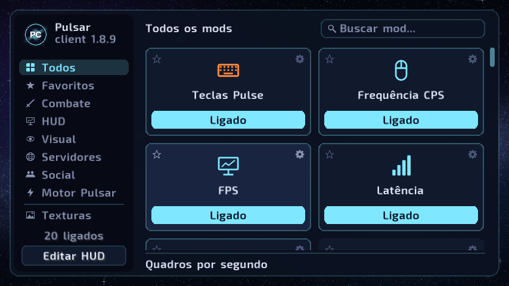
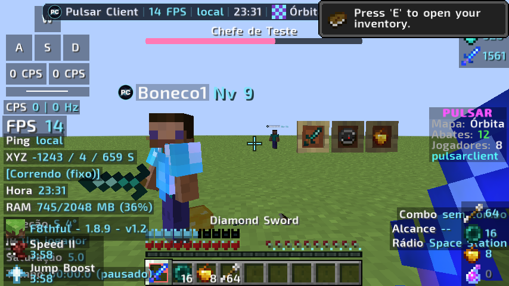
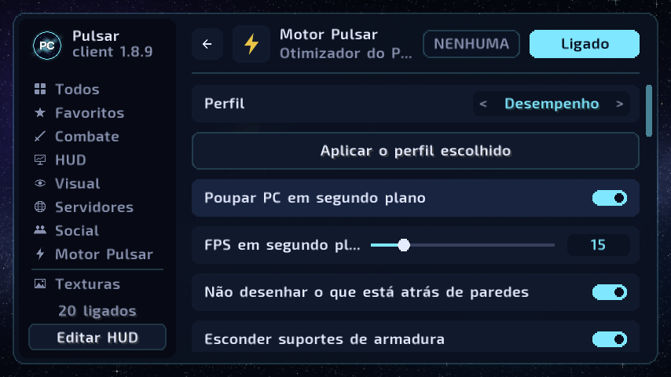

  

<h1 align="center">Pulsar Client</h1>

  <b>O client de PvP para Minecraft 1.8.9 feito para PC fraco e para o FullPvP.</b> 
  Mais FPS no meio da treta, HUD limpa e mods pensados para quem vive de combo, pote e caixa.

  <a href="https://github.com/R0N1234/Pulsar_Client/releases/latest"><b>⬇️ Baixar para Windows</b></a>
  &nbsp;·&nbsp;
  <a href="https://discord.gg/UUW5jTfDKH">💬 Discord do Pulsar</a>
  &nbsp;·&nbsp;
  <a href="https://github.com/R0N1234/Pulsar_Client/issues/new?template=sugestao.yml">💡 Mandar sugestão</a>
  &nbsp;·&nbsp;
  <a href="https://github.com/R0N1234/Pulsar_Client/issues/new?template=problema.yml">🐞 Avisar de um problema</a>

  
  

---

## 🚀 Por que o Pulsar?

**Feito para PC fraco.** O **Motor Pulsar** é um otimizador próprio que entra dentro do jogo: não desenha o que está atrás de parede, deixa leve quem está longe, corta grama alta, flores e partículas em excesso e segura o FPS quando o jogo fica em segundo plano. Numa mina de FullPvP com 40 jogadores, só os mais perto de você ficam com todos os detalhes. Os de longe continuam com a skin, mas sem o peso da armadura e do item na mão.

**Feito para o FullPvP.** CPS, combo, alcance, durabilidade da armadura, contador de potes e pérolas, tempo de recarga das maçãs, TNT, zoom, mira personalizada e a Barra Pulsar no topo da tela com FPS, ping e hora. Tudo arrastável no editor de HUD.

**Bonito sem pesar.** Tema espacial do começo ao fim: menu com um universo 360° girando devagar (Andrômeda, os planetas e um pulsar), painel com ícones e favoritos, fonte própria. Tudo desenhado para custar quase nada de FPS.

**Fácil de usar.** Um launcher só: entra com a conta Microsoft, baixa o Java e o Forge sozinho, atualiza sozinho e funciona com ou sem OptiFine. Dois visuais, trocados em Ajustes: **Normal** (painel de lançamento à direita, mods em cartões e ajustes por abas) e **Lite** (a tela leve, com as órbitas).

**Outras versões de PvP.** Além da 1.8.9 com o Pulsar, o launcher abre a **1.7.10**, a **1.16.5** e a **1.21.8** no Minecraft puro, cada uma com a sua pasta e o Java certo baixado sozinho.

  
  

## 🧩 Mods

**HUD**
- **Barra Pulsar**: mini painel no topo com o client, FPS, ms, hora e a música que está tocando no Spotify (com capa)
- **Teclas Pulse** e **Frequência CPS**: WASD, cliques e CPS na tela
- **FPS**, **Latência**, **Coordenadas**, **Bússola**, **Relógio**, **Memória**, **Servidor**, **Saturação** e **Cronômetro**
- **Placar** (sem os números vermelhos), **Lista do TAB** (cabeça da skin e ping em número), **Barra de Chefe** e **Pacote Ativo**

**Combate**
- **Combo**, **Alcance**, **Blindagem**, **Efeitos**, **Contador de Itens**, **Recargas** e **Contador TNT**
- **Mira de Pulsar** (formato, cor, tamanho e contorno), **Impacto**, **Campo de Colisão** e **Tremor de Dano**
- **Animações Clássicas** (bloqueio e swing da 1.7), **Propulsão** (correr fixo) e **Inventário** (trava itens contra drop)
- **Focar Jogador** (na treta, aperte a tecla para focar quem te bateu: nick destacado e caixa em volta dele) e **Sequências de Abate** (FIRST BLOOD, DOUBLE KILL... GODLIKE em letras de sangue, com a voz do Pulsar; troque as vozes pelos seus .ogg em `pulsar/sons/sequencias/`)
- **Anti-Batata** (contagem ou tela piscando quando a regeneração da maçã dourada vai acabar, e pode comer outra sozinho) e **Filtro de Coleta** (verde pega, vermelho descarta: escolha os itens de PvP que entram no inventário)

**Visual**
- **Telescópio** (zoom), **Órbita Livre** (câmera 360° em volta do personagem), **Fonte do Pulsar** e **Cores Vivas**
- **Aura de Encanto** (cor do brilho de encantamento, até arco-íris), **Contorno**, **Supernova**, **Atmosfera**, **Poeira Estelar**, **Rastro de Cometa**, **Gravidade de Itens**, **Nebulosa** e **Meu Nick**

**Servidores e social**
- **Atalhos de Texto** (uma tecla manda /lobby, /home...), **GG Automático**, **Sinal Discord** e **Capturas**
- **Gravação** (como no Lunar: F9 grava o jogo, F10 salva um clipe dos últimos segundos; vídeos em `Vídeos/Pulsar Client`)

**Motor Pulsar**
- Perfis **Desempenho**, **Desempenho + Qualidade** e **Qualidade+**, com cada parte ajustável

## 📥 Como instalar

1. Baixe o **Pulsar-Client-Instalador** na [página de lançamentos](https://github.com/R0N1234/Pulsar_Client/releases/latest).
2. Abra o instalador. Ele instala e abre o launcher sozinho.
3. Entre com a sua conta Microsoft (a que tem o Minecraft) e clique em **JOGAR**.

No jogo, aperte **Shift direito** para abrir o painel de mods. O launcher atualiza sozinho quando sai versão nova.

## 🔊 Suas próprias vozes nas Sequências de Abate

O mod vem com a voz do Pulsar (sintética, feita para o client, sem áudio de terceiros). Para trocar, coloque arquivos **.ogg** na pasta `.minecraft/pulsar/sons/sequencias/` com estes nomes (um por sequência; os que faltarem continuam com a voz do Pulsar):

| Abates | Texto na tela | Arquivo |
|---|---|---|
| 1 | FIRST BLOOD | `first_blood.ogg` |
| 2 | DOUBLE KILL | `double_kill.ogg` |
| 3 | TRIPLE KILL | `triple_kill.ogg` |
| 4 | MULTI KILL | `multi_kill.ogg` |
| 5 | MEGA KILL | `mega_kill.ogg` |
| 6 | ULTRA KILL | `ultra_kill.ogg` |
| 7 | MONSTER KILL | `monster_kill.ogg` |
| 8 | KILLING SPREE | `killing_spree.ogg` |
| 9 | RAMPAGE | `rampage.ogg` |
| 10 | DOMINATING | `dominating.ogg` |
| 11 | UNSTOPPABLE | `unstoppable.ogg` |
| 12 ou mais | GODLIKE | `godlike.ogg` |

No painel dá para trocar para a lista **Arena**, dos shooters clássicos: FIRST BLOOD, DOUBLE KILL, MULTI KILL, MEGA KILL, ULTRA KILL, MONSTER KILL, LUDICROUS KILL (`ludicrous_kill.ogg`) e HOLY SHIT (`holy_shit.ogg`, 8 ou mais). Os nomes repetidos usam o mesmo arquivo nas duas listas.

**Vozes.** Para ter mais de uma voz, use um prefixo no nome ou uma subpasta: `MASCULINO_double_kill.ogg` ou `MASCULINO/double_kill.ogg`. Cada prefixo ou pasta vira uma opção em **Voz** no painel do mod (a **Padrão** é a voz do Pulsar). Variações do mesmo som terminam em `_2`, `_3`... (`MASCULINO_holy_shit_2.ogg`) e são sorteadas a cada abate. O nome pode vir com ou sem sublinhado (`multikill.ogg` vale como `multi_kill.ogg`); o que faltar numa voz cai na voz do Pulsar.

O arquivo é lido na hora de tocar, então basta salvar o .ogg e esperar o próximo abate. Use **Testar todos os sons** no painel do mod para ouvir a lista inteira na voz escolhida e **Procurar sons novos na pasta** se um arquivo recém-copiado não apareceu. Só .ogg (Vorbis) funciona, mono ou estéreo; um .mp3 ou .wav não toca.

## 🎥 Gravação, como no Lunar

Com o mod **Gravação** ligado, **F9** começa e para a gravação (aparece **REC** na tela) e **F10** salva um **clipe** dos últimos segundos (de 15 a 120, escolha no painel). Para o clipe funcionar a qualquer hora, ligue **Clipe sempre pronto**; senão, o primeiro F10 começa a guardar e o próximo salva. Qualidade (720p, 1080p ou a tela inteira), 30 ou 60 FPS, som do jogo e microfone são opções do mod. Os vídeos ficam em `Vídeos/Pulsar Client`, e o chat mostra os botões **Abrir** e **Pasta** quando um vídeo é salvo. Quem grava é o launcher (ele precisa estar aberto, como sempre está).

## ❓ Perguntas rápidas

**Posso usar em qualquer servidor?** O Pulsar é feito de HUD, visual e desempenho, como os clients conhecidos. Mesmo assim, cada servidor tem as suas regras: na dúvida, confira quais mods são permitidos lá.

**Funciona com OptiFine?** Sim. No launcher, escolha o modo **Pulsar + OptiFine**.

**A Barra Pulsar mostra a música de que jeito?** Ela lê a música pelos controles de mídia do Windows, sem login e sem pedir senha do Spotify. A capa vem da busca pública do iTunes, e dá para desligar a capa nas opções da barra.

**Achei um problema ou tenho uma ideia.** Chame no [Discord do Pulsar](https://discord.gg/UUW5jTfDKH), use o botão **Sugestões** no menu do jogo ou abra uma [sugestão](https://github.com/R0N1234/Pulsar_Client/issues/new?template=sugestao.yml) ou um [problema](https://github.com/R0N1234/Pulsar_Client/issues/new?template=problema.yml) aqui no GitHub.

---

<b>Para quem quer mexer no código</b>

| Pasta | O que é | Tecnologia |
|---|---|---|
| `launcher/` | O programa que abre no PC: login, mods, ajustes e o botão JOGAR | Electron (Node.js) |
| `mod/` | O que roda dentro do Minecraft: HUD, mods, painel e o Motor Pulsar | Forge 1.8.9 (Java 8) |
| `wtap/` | W-Tap e Blockhit como um mod Forge separado | Forge 1.8.9 (Java 8) |
| `tools/` | Geradores da arte (universo, planetas, ícones e logo) | Python + Pillow |

Compilar o mod: `cd mod && ./gradlew build` (precisa do Java 21 para o Gradle e do Java 8 para o jogo).
Abrir o launcher: `cd launcher && npm install && npm start`.

Cada push roda o jogo de verdade no CI (Linux, Windows e com OptiFine), passa por todas as telas e mods e confere o log.
Para lançar uma versão: **Actions** > **Lançar versão** > **Run workflow**, com o número da versão e o que mudou.

Pulsar Client não é afiliado à Mojang nem à Microsoft. Minecraft é marca da Mojang AB.

